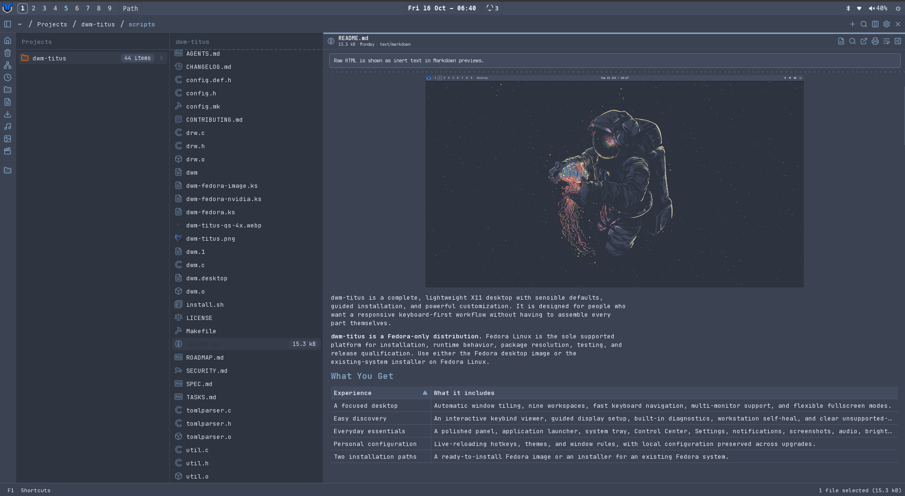
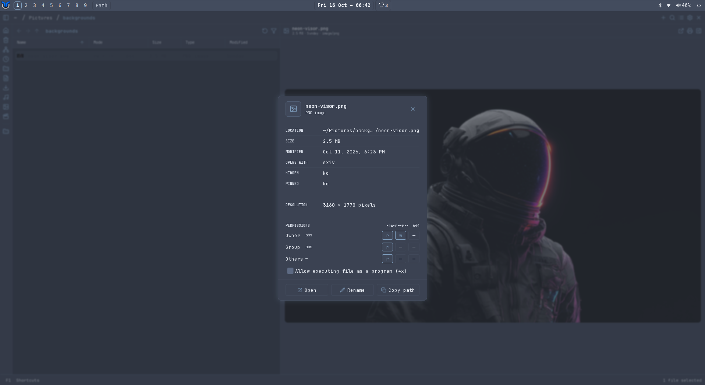
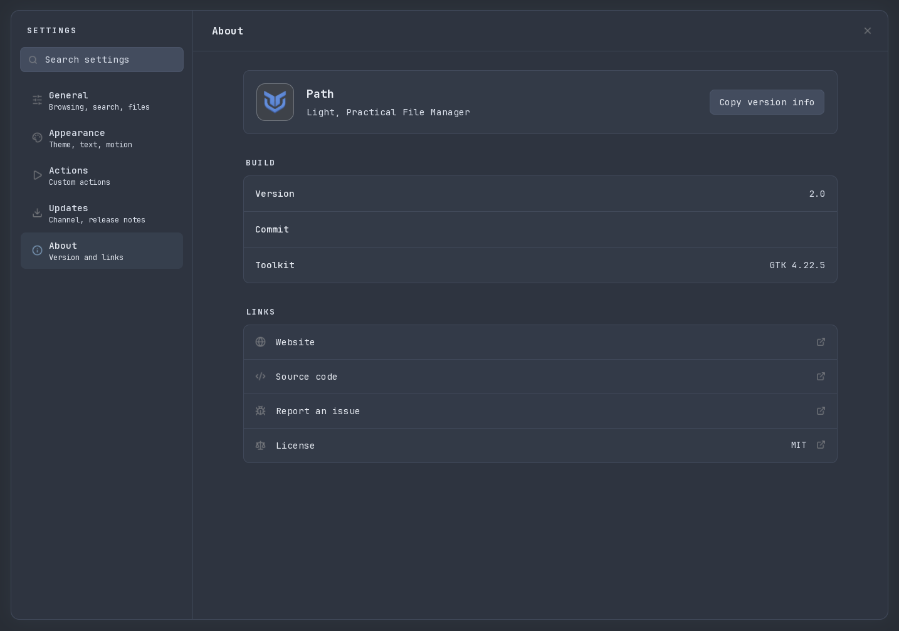

# Path

**Light, Practical File Manager**

**Path v2.0** is a fast, keyboard-first GTK4 file manager for Linux written in Rust. It combines spatial Miller-column navigation with familiar Icons and List views, instant recursive fuzzy search, sandboxed file previews, and native X11/Wayland desktop integration.

<p align="center">
  
</p>
<p align="center">
  
</p>
<p align="center">
  
</p>

---

## Highlights

* **Three Browser Modes:** Switch seamlessly between spatial **Columns**, an **Icons** grid, and a sortable **List** table, with optional **10xer** keyboard mode (`Ctrl+Shift+M`) for modal navigation.
* **Fast Recursive Search:** Press `Ctrl+K` for multi-threaded fuzzy filename and path search across Home and mounted local drives, or `Ctrl+F` to filter the active pane in place.
* **Sandboxed Rich Previews:** Untrusted image, camera RAW, PDF, thumbnail, audio, and video parsers run out of process inside **Bubblewrap** (`bwrap`) with no network access and strict resource bounds. Video previews auto-discover available hardware decoding at runtime with automatic CPU software fallback. Text, source code (`GtkSourceView 5`), Markdown, and static HTML render natively.
* **Remote Locations & Devices:** Browse **GIO / GVfs** mounts including SMB shares (`smb://`), SFTP servers (`sftp://` with interactive host-key and credential prompts), mobile devices (MTP/PTP/AFC), and removable or encrypted UDisks2 volumes.
* **XDG Desktop Portal & D-Bus Provider:** Implements `org.freedesktop.impl.portal.FileChooser` (`pathfm.portal`, including caller-initiated `org.freedesktop.portal.Request.Close` cancellation) and `org.freedesktop.FileManager1` (`ShowFolders`, `ShowItems`, `ShowItemProperties`).
* **Custom Actions & Themes:** Extend context menus with Python, Bash, or command recipes under `~/.config/pathfm/actions/` with live progress in the Jobs dashboard, and customize appearance with bundled themes or TOML themes under `~/.config/pathfm/themes/`.

---

## Architecture Overview

```
┌──────────────────────────────────────────────────────────────┐
│                   GTK4 / Cairo UI (pathfm)                   │
│       Columns · Icons · List · Quick Preview · Chooser       │
└──────────────┬───────────────────────────────┬───────────────┘
               │                               │
┌──────────────▼──────────────┐ ┌──────────────▼───────────────┐
│  Async Services & Indexer   │ │   D-Bus Desktop Providers    │
│  Search · Jobs · Actions    │ │  FileChooser · FileManager1  │
└──────┬───────────────┬──────┘ └──────────────────────────────┘
       │               │
┌──────▼──────┐ ┌──────▼───────────────────────────────────────┐
│ Local & GIO │ │     Bubblewrap Preview Sandbox (bwrap)       │
│ GVfs · SFTP │ │  Images · RAW · PDF · FFmpeg / GStreamer     │
└─────────────┘ └──────────────────────────────────────────────┘
```

---

## Dependencies

### Runtime
* **Core Libraries:** `gtk4` ($\ge 4.12$), `gtksourceview5`, `poppler-glib`, `fontconfig`, `gstreamer1`, `gstreamer1-plugins-base`, `gstreamer1-plugins-good`
* **Isolation & Storage:** `bubblewrap` (`bwrap`), `gvfs` (plus optional `gvfs-smb` for SMB shares)
* **Desktop Integration:** `xdg-desktop-portal`, `xdg-desktop-portal-gtk`, `hicolor-icon-theme`
* **Optional Preview Helpers:** `ffmpeg` / `ffmpegthumbnailer` (video previews and thumbnails), `imagemagick` & `libraw` / `dcraw` (extended camera RAW and HEIC decoding), `squashfs-tools` (AppImage icon extraction)

### Build Dependencies
* `rust` & `cargo` (Rust 2024 toolchain)
* `gcc` / `gcc-c++`, `pkgconf`, `make`, `python3`, `desktop-file-utils`
* Development headers:
  * **Fedora:** `gtk4-devel`, `gtksourceview5-devel`, `poppler-glib-devel`, `gstreamer1-devel`, `gstreamer1-plugins-base-devel`, `fontconfig-devel`
  * **Arch Linux:** `gtk4`, `gtksourceview5`, `poppler-glib`, `gstreamer`, `gst-plugins-base`, `fontconfig`

---

## Installation

### Fedora (COPR)

```bash
sudo dnf copr enable christitustech/copr-fedora
sudo dnf install path
```

### Building from Source (`Makefile`)

```bash
# Build release binary
make build

# Install binary, desktop entry, icons, D-Bus service, and portal files
sudo make install PREFIX=/usr
```

To uninstall:

```bash
sudo make uninstall PREFIX=/usr
```

### Packaging Assets
* **Fedora / RHEL:** RPM spec file at [`packaging/fedora/path.spec`](packaging/fedora/path.spec) and SRPM generator at [`packaging/fedora/make_srpm.py`](packaging/fedora/make_srpm.py).
* **Arch Linux:** AUR package template at [`packaging/aur/PKGBUILD.in`](packaging/aur/PKGBUILD.in).

---

## Usage

Start Path from a terminal, window-manager keybinding, or application launcher:

```bash
# Open home directory
pathfm

# Open a specific directory
pathfm /path/to/directory

# Print version
pathfm --version
```

### Common Shortcuts

| Shortcut | Action |
| :--- | :--- |
| `Ctrl+K` | Global recursive fuzzy search |
| `Ctrl+L` | Edit location path or remote URI (`sftp://`, `smb://`) |
| `Ctrl+F` | Filter current folder pane |
| `Space` | Toggle quick preview |
| `F2` | Rename selected item(s) |
| `Ctrl+Z` / `Ctrl+Shift+Z` | Undo / Redo reversible file operation |
| `Ctrl+Shift+M` | Toggle 10xer keyboard navigation mode |
| `Ctrl+,` | Open Settings |
| `F1` | Keyboard shortcut reference |

### Default Folder Handler

To set Path as your user account's default file manager for folders:

```bash
xdg-mime default pathfm.desktop inode/directory
```

On a fresh dwm-titus account, its default-app seeding chooses `pathfm.desktop`
when Path is available and falls back to Thunar otherwise. Existing user MIME
preferences are preserved. The folder default is separate from the XDG portal
file chooser: dwm-titus keeps GTK as its chooser unless you explicitly enable
Path through **Settings → General → System file chooser → Configure…**. See the
[file chooser guide](docs/portal-file-chooser.md) for that optional integration.

Path identifies its main window as `io.github.christitustech.Path` and chooser
windows as `io.github.christitustech.Path.FileChooser`. Older dwm-titus rules
for Path v1 dialog titles do not apply to Path-v2's in-window dialogs.

---

## Development & Testing

```bash
# Check formatting, Clippy lints, and branding invariants
make lint

# Run Rust unit and integration tests
make test-rust

# Run headless end-to-end UI tests
make test-e2e
```

Additional architecture and feature documentation is available under [`docs/`](docs/architecture.md).

---

## License

MIT License. See [LICENSE](LICENSE) for details.
